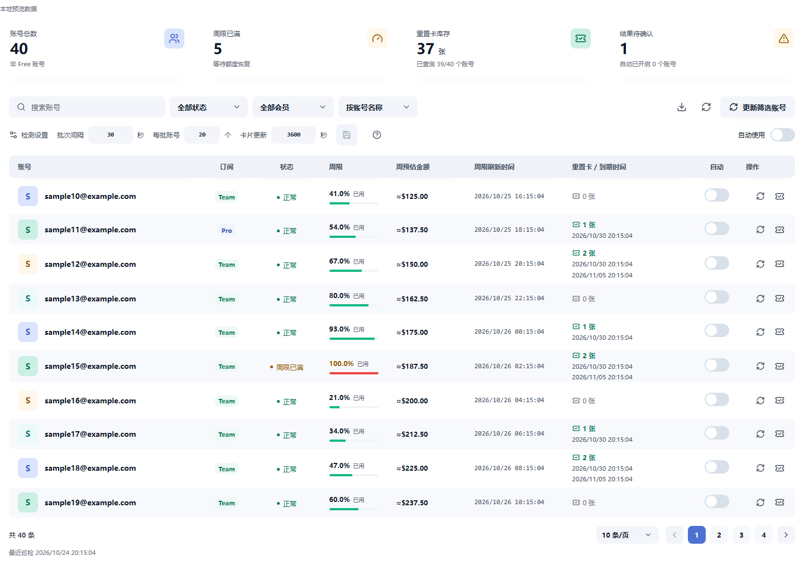
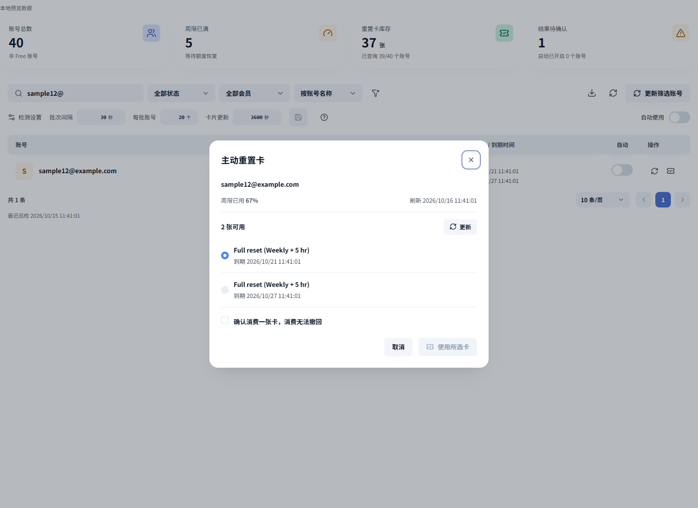

# 周限与重置卡

独立 RS 网关插件，插件 ID 为 `personal.quota-manager`，源码基线版本 `0.3.1`，自动发布使用 UTC 时间版本号，公开安装包以 Releases 为准。

对应最新稳定宿主 **RS v3.34.0**，SDK 与官方打包工具固定提交 `47d30474af7c3e1fab433f2d4a70430fae548ff2`，保留 RS v3.33.x 兼容。清单为 v2、进程协议为 **RPC v7**，声明 management v2 与 maintenance v1；页面宿主桥仍为 v2。UI 使用 v0.7.0。见 [发布说明](docs/releases/v0.3.1.md)与 [SDK 差异及适配记录](docs/SDK-UPGRADE-v0.3.1.md)。

## 安装与兼容

- 下载：[安装包与校验文件](https://github.com/AlisaCat-S/rs-quota-manager/releases)
- 当前源码宿主兼容范围：`>=3.33.0, <3.35.0`。RPC v7 不兼容 v5/v6 宿主；v3.30.x–v3.31.x 使用本插件 0.2.x 源码对应的发行包，v3.32.x 需使用 RPC v6 插件。RS v3.34.0 不自动启动宿主范围不匹配的插件；从本插件 0.3.0 升级时，安装本次重新构建、打包的制品，不依赖一次性风险确认。
- 自动构建目标：Linux x86_64 与 ARM64（aarch64），glibc 2.28 及以上；未提供 Windows 或 macOS 安装包。可用版本与附件以 Releases 为准。
- 插件 ID：`personal.quota-manager`。为保留既有安装配置和私有状态，继续沿用该身份。
- 许可证：Apache-2.0，第三方来源见 [LICENSES/NOTICE.md](LICENSES/NOTICE.md)。

在 RS 的“插件管理 → 安装插件 → GitHub”中填写 `AlisaCat-S/rs-quota-manager`，版本标签留空查询最新稳定版，选择匹配架构的 `.tar.gz` 附件。
也可从 Release 下载 `.tar.gz` 与 `checksums.txt`，核对 SHA-256 后，通过“上传”安装。不要上传 GitHub 自动生成的 Source code 归档。
安装时确认来源与插件权限，创建并启用配置，再从侧栏打开“周限与重置卡”。已有安装可通过宿主版本切换更新，保留实例与私有状态。

以下截图全部为本地模拟数据，不含真实账号、卡片或消费结果。





## 安全边界

自动使用默认关闭。开启自动使用或确认手动消费会通过宿主调用上游接口，可能真实消耗重置卡，消费无法撤回。
只对支持重置的 OpenAI OAuth 非 Free 账号执行卡片操作；已停用账号不参与自动消费，不修改账号启用状态或分组。
结果不确定时保留原请求标识并阻止再次消费其他卡片；总开关关闭不能撤回已经发出的请求。
公开验证覆盖规则、协议、页面及安装流程，未执行真实卡片消费；不同上游套餐与卡片格式仍可能存在兼容性差异。
CSV 包含账号 ID、完整名称和邮箱，若原名称含敏感内容，请勿将导出内容公开。

## 使用

使用 Release 安装包时，按该版本发行说明核对宿主范围和 SHA-256，再从插件管理安装、启用配置并打开“周限与重置卡”。当前源码需要先按下文构建，不能用旧 Release 安装包代替新版构建。

- 读取 RS 当前账号套餐和启用状态，排除套餐为 Free 的账号，账号列只显示完整邮箱，无邮箱时回退到名称；列表同时显示会员标识、周限、刷新时间、卡张数及到期时间，内部 ID 与账号名称仍参与搜索和导出
- 按宿主真实 `planType` 判断套餐，名称带 `team+` 的 Free 同样排除，列表、汇总、后台查询和新消费共用该规则
- 账号页默认读取已有额度观测和插件卡片缓存，卡片未查询会显示“未查询”，不会显示成零张
- “周预估金额”位于周限和刷新时间之间，显示宿主根据本地用量记录计算的本周期预估总金额（USD）。随页面每 30 秒读取快照更新，也可点击“读取最新快照”立即更新；不发起远程额度查询。无金额预估时显示“暂无预估”，悬停查看原因、样本提示和预估时间；CSV 末尾附带预估金额与说明
- “更新筛选账号”按当前筛选逐个查询额度和卡片，两号之间间隔一秒，可以停止后续查询，关闭页面后不继续批量更新
- 手动使用通过每行的卡片图标打开，选择一张卡并确认消费
- 自动使用默认关闭，总开关直接同步全部适用账号，不显示启用确认弹窗，开启后仍可逐号关闭；全局关闭时所有账号均停止自动使用并显示关闭，账号原有启用状态保持不变
- 总开关关闭时单独开启某个账号，只开启该账号，其他账号保持关闭，逐号设置保存后刷新或重启仍生效
- 日期按浏览器本地时区显示，支持搜索、筛选、排序和 CSV 导出；隔离页面不支持下载导航，导出改为官方弹窗中的只读 CSV 和复制、全选操作，不扩展宿主权限。分页复用 RS 使用统计的 ZPagination，默认每页 10 条，可选 10、20、50、100 条及页码跳转；容器过窄时隐藏每页条数选择框，保留翻页和当前页码
- 页面复用公开 ZCard 指标卡、ZTag 会员标签、输入框、开关、表格、分页和选卡控件，随宿主主题同步，可按会员标识和状态筛选
- 检测间隔、批次大小和卡片更新间隔直接显示在工具栏，点击保存图标提交，未保存的修改可撤销，后台快照更新不会覆盖草稿
- 后台刷新不禁用筛选与分页，不覆盖用户刚修改的开关，批量更新失败时保留账号列表

## 自动规则

每批默认检查 20 个账号，批次间隔 30 秒，沿账号 ID 轮转，每批至多一个账号访问上游，后台与管理操作共用串行入口

自动触发只识别 `codex` 通用桶的唯一 604800 秒窗口，窗口未过期、最新额度观测不超过两分钟且已用比例达到 100% 才能消费
消费前通过宿主刷新额度和卡片列表，优先使用最早到期、仍可用且明确包含周限的卡，5 小时额度或模型专属周限不触发自动操作

完整巡检时间取决于宿主账号总数及上游延迟，巡检分页会跳过 Free，维护调用由宿主每 30 秒唤醒
卡片缓存默认每小时更新，首次查询采用轮转渐进填充；需要完整的新鲜库存时使用“更新筛选账号”

UUID 在消费前通过宿主私有状态持久化，结果不确定时暂停该号自动消费，并保留原卡与原 UUID
“确认原操作”只复用原请求标识，不选择另一张卡，进程重启仍保留未决操作，账号降为 Free 时移出业务列表，其原有未决操作单独保留确认入口
确认成功后回读额度与卡片；额度尚未恢复时保持等待状态，直到收到消费后的低于 100% 的新周限观测

每号保留最近 20 条已确认业务结果，宿主原生消费接口同时保留其自身的审计语义
关闭自动开关阻止后续自动消费，已经发出的消费请求不会被撤回

RS 新版另有“临期重置卡自动使用”，与本插件“周限耗尽时重置”的策略、开关和请求标识相互独立。本插件不修改宿主原生自动使用设置；同一账号建议只启用一种自动策略。宿主原生操作未决时可能返回 HTTP 409，本插件保留原卡与原 UUID，待冲突解除后通过“确认原操作”继续。

RS v3.34.0 新增的受管推理 HTTP 429 有限重放不适用于重置卡管理请求。重置卡请求遇到 429 或会话中断时，仍保留未决操作，不自动重发；恢复后通过“确认原操作”复用原卡与原 UUID。

## 构建

全部构建与验证在本机运行，生产服务器只接收完成的安装包
Rust 使用 1.99.1，前端使用 Node 24 和 pnpm，SDK 与前端依赖由锁文件固定。以下 `cargo` 命令需在 Rust 1.99.1 工具链下执行。

```powershell
pnpm --dir frontend install --frozen-lockfile
pnpm --dir frontend build
cargo fmt --manifest-path backend/Cargo.toml -- --check
cargo clippy --manifest-path backend/Cargo.toml --all-targets --locked -- -D warnings
cargo test --manifest-path backend/Cargo.toml --locked
cargo build --manifest-path backend/Cargo.toml --locked
node verification/protocol-test.mjs
node verification/frontend-test.mjs
node --test .github/scripts/release-version.test.mjs
pnpm --dir frontend exec playwright install chromium --only-shell
node verification/ui-test.mjs
```

Windows 本机生成 Linux 制品需要安装 Zig、cargo-zigbuild 和 Rust Linux target，把 Zig 与 cargo-zigbuild 加入 PATH

```powershell
rustup target add x86_64-unknown-linux-gnu
cargo zigbuild --manifest-path backend/Cargo.toml --release --locked --target x86_64-unknown-linux-gnu.2.28
cpr-plugin package --manifest plugin.json --binary backend/target/x86_64-unknown-linux-gnu/release/quota-manager --target x86_64-unknown-linux-gnu --resource-map web=frontend/dist --resource-map legal=LICENSES --output-dir dist
```

`cpr-plugin` 应从上面的宿主固定提交构建，安装包支持 Linux x86_64 与 ARM64、glibc 2.28 及以上。手动构建 ARM64 时，将上述命令中的 `x86_64-unknown-linux-gnu` 全部替换为 `aarch64-unknown-linux-gnu`，包括安装 Rust target、构建参数和二进制路径，保留 `.2.28` 后缀。
Linux 原生开发可直接使用 `cargo build --release --target x86_64-unknown-linux-gnu` 后用同一 CLI 打包

## 自动构建与发布

推送到 `main` 的代码变更会自动构建并发布；仅修改 Markdown、`docs/` 或许可证文件不触发发布。也可在 [Actions → Build and release](https://github.com/AlisaCat-S/rs-quota-manager/actions/workflows/release.yml) 选择 `main`，点击 **Run workflow** 手动发布。其他分支手动运行和面向 `main` 的 PR 只验证、构建并保存 Actions 制品，不创建 Release。

版本格式为 `YYYYMMDD.HHMMSS.运行序号`（UTC），例如 `20261024.103059.42`，标签为 `v20261024.103059.42`。SemVer 数字段不保留前导零，例如午夜为 `20261024.0.42`。同一次构建的两个架构共用版本；重新运行整个工作流会生成新的时间版本，只重跑失败任务则沿用原版本。仅构建工作区的 `plugin.json` 被写入发布版本，不向源码提交回写版本号。

流程先执行 Rust 检查、协议测试、前端构建和浏览器回归，再用 Zig 按 glibc 2.28 交叉构建两种架构，分别运行模拟宿主协议测试（ARM64 使用 QEMU）。打包工具固定到与 SDK 相同的上游提交。两个架构全部通过后才创建 Release，附件包括：

- `personal.quota-manager-<版本>-x86_64-unknown-linux-gnu.tar.gz`
- `personal.quota-manager-<版本>-aarch64-unknown-linux-gnu.tar.gz`
- 各包同名 `.tar.gz.sha256` 与汇总 `checksums.txt`

Release 标注源码基线 v0.3.1、对应宿主 RS v3.34.0、RPC v7、源码提交、构建记录与宿主兼容范围。上传先进入草稿，全部成功后再公开；失败草稿可在该次构建记录定位并处理，不覆盖既有版本附件。此流程不部署用户网站，也不调用真实自动消费或重置卡接口。

## 上游复用

按 Issue #278、官方 UI 安装文档和 plugins/workbench 示例核对，详见 `verification/UPSTREAM-COMPLIANCE.md`。
UI 通过官方 v0.7.0 编译发行包安装，完整性由 pnpm 锁文件 integrity 固定；业务代码只导入公开组件、样式、主题、语言包与 Vite 入口。根级 `ZConfigProvider` 使用 `zhHans`，保留中文分页、选择框与弹窗控件。
插件示例仓库不是运行时依赖，复用其公开宿主桥、请求层与运行时解码组织方式，不导入其内部业务代码，也不降级当前宿主 SDK。
来源与许可见 `LICENSES/NOTICE.md`，随插件包一并提供。

## 验证边界

`verification/protocol-test.mjs` 启动真实插件进程，以模拟宿主验证握手、分页、设置冲突、自动触发、卡片选择、暂停状态、不确定结果、重启恢复及幂等键复用
测试不访问真实网关或真实上游，不消费真实卡片

`pnpm --dir frontend dev --port 5176` 提供带明确标识的本地模拟预览，发行页面只使用 `window.codexProxyPlugin` 宿主桥，不请求管理员密码或读取管理 Cookie
当前源码声明兼容 `>=3.33.0, <3.35.0`；本次验证包括 v3.33.0 / v3.34.0 的宿主合同快照、RPC v5/v6 宿主排除、新 SDK 插件进程的挂起/恢复授权、回调回收、取消/超时、管理请求 429 不自动重放、会话中断后原操作确认与原有业务回归，以及浏览器模拟页面。尚未执行这两个宿主版本的真实安装验收；旧版在 v3.26.2 的安装记录见历史验证文档。真实卡片消费未执行。

`verification/ui-test.mjs` 自动启动独立本地预览，验证中文控件、分页、筛选、选卡确认、CSV 和深色窄屏，另以模拟的 10000 个账号验证四位页码与 220px 分页容器，并将截图写入忽略目录 `verification/ui-artifacts/`。

## 页面加载排查

宿主会校验页面资源的 sandbox CSP 和 `X-Content-Type-Options: nosniff`
Nginx 同时透传上游同名头并追加 `nosniff` 会产生 `nosniff, nosniff`，从而触发“服务返回了不受支持的响应”
在已有 Nginx `add_header X-Content-Type-Options nosniff always;` 的站点中，使用 `proxy_hide_header X-Content-Type-Options;` 保留单个安全头
修改需要备份并通过配置检查，平滑重载须保留在途连接；浏览器缓存旧响应头时需强制刷新页面
